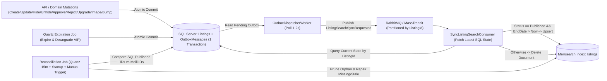

# Tài liệu Triển khai Meilisearch & Đồng bộ Tìm kiếm Chính xác (PropNest)

> **Nhánh mục tiêu:** `bao/opimize-project-1`  
> **Mục tiêu:** Thay thế truy vấn `Contains()` trên SQL Server bằng **Meilisearch** cho trang tìm kiếm Client, bổ sung bộ lọc địa giới hành chính Việt Nam (trước & sau sáp nhập) + thông số bất động sản, đồng thời đảm bảo **đồng bộ dữ liệu chính xác tuyệt đối** qua mọi biến cố vòng đời tin đăng (hết hạn, sửa nội dung/ẩn/duyệt lại, hạ gói VIP, và đẩy tin trong tương lai).

---

## 1. Kiến trúc tổng thể & Nguyên tắc thiết kế

### 1.1. Phân tách Source of Truth vs Search Projection

| Thành phần | Vai trò | Phạm vi sử dụng |
|---|---|---|
| **SQL Server (`PropNestDbContext`)** | **Source of Truth duy nhất** (ACID) | Lưu trữ toàn bộ nghiệp vụ, giao dịch ví, kiểm duyệt, lịch sử thay đổi, Outbox. Seller & Admin Portal đọc trực tiếp từ SQL Server. |
| **Meilisearch (`listings` index)** | **Read-Optimized Search Engine** (Eventual + Guarded Consistency) | Phục vụ tìm kiếm toàn văn tiếng Việt, chịu lỗi gõ sai (typo), lọc đa chiều (giá, diện tích, địa chỉ trước/sau sáp nhập, thông số), đếm facets và sắp xếp thứ hạng cho `Web.Client` (`GET /api/v1/listings`). |
| **SQL Fallback (`ListingRepository`)** | **Lưới an toàn khi sự cố** | Nếu Meilisearch container down hoặc timeout (`> 2s`), API tự động fallback về SQL Server query kèm log cảnh báo, đảm bảo Client không bị lỗi `500`. |

### 1.2. Output kỳ vọng sau khi hoàn thành toàn hệ thống

1. **Hạ tầng:** Container `propnest-meilisearch` chạy ổn định trong `docker-compose.yml`, API & Worker kết nối qua internal network `propnest-network`.
2. **Tốc độ & UX tìm kiếm:** Truy vấn full-text + đa bộ lọc trên `listings` trả kết quả `< 30ms` tại Meilisearch, hỗ trợ tiếng Việt có dấu / không dấu (kể cả ký tự `đ/Đ`), lọc đồng thời địa chỉ **sau sáp nhập** (`City/District/Ward/ProvinceCode`) và **trước sáp nhập** (`LegacyAddress`), trả về kèm ảnh cover thật (`ThumbnailUrl`) và số lượng facet.
3. **Độ chính xác đồng bộ 100%:**
   - **Tin A hết hạn:** Không bao giờ xuất hiện trong kết quả search ngay từ giây `00:00:00 +07:00` (trước cả khi background job kịp chạy), sau đó bị xóa khỏi index.
   - **Tin B cập nhật / ẩn / khôi phục / đổi ảnh:** Khi sửa nội dung (`PendingModeration`) hoặc `Hide`, tin biến mất ngay khỏi search; khi duyệt lại (`Approve`) hoặc `Unhide` hoặc đổi ảnh bìa, dữ liệu mới nhất trên SQL được cập nhật vào Meilisearch.
   - **Tin C đổi thứ hạng (VIP hết hạn & Đẩy tin):** Hết hạn VIP tự tụt về nhóm `Standard`; khi kích hoạt **Đẩy tin (Bump)** trong tương lai, tin lập tức nhảy lên đầu nhóm tương ứng mà không cần sửa lại kiến trúc đồng bộ.

---

## 2. Hạ tầng & Cấu hình triển khai (Phase 1)

### 2.1. Bổ sung service vào `docker-compose.yml`

Thêm container `meilisearch` cùng volume `meilisearch_data` vào `propnest-network`, và cấp biến môi trường cho `api` và `worker`:

```yaml
  meilisearch:
    image: getmeili/meilisearch:v1.11
    container_name: propnest-meilisearch
    restart: unless-stopped
    environment:
      MEILI_ENV: "development"
      MEILI_MASTER_KEY: "PropNest_Meili_Dev_MasterKey_2026"
      MEILI_NO_ANALYTICS: "true"
    ports:
      - "7700:7700"
    volumes:
      - meilisearch_data:/meili_data
    healthcheck:
      test: ["CMD-SHELL", "wget -q --spider http://127.0.0.1:7700/health || exit 1"]
      interval: 10s
      timeout: 5s
      retries: 10
      start_period: 10s
    networks:
      - propnest-network
```

Biến môi trường bổ sung cho `api` và `worker`:

```yaml
      Meilisearch__Url: "http://meilisearch:7700"
      Meilisearch__MasterKey: "PropNest_Meili_Dev_MasterKey_2026"
      Meilisearch__ListingsIndexName: "listings"
      Meilisearch__Enabled: "true"
      Meilisearch__RequestTimeoutMs: "2000"
```

### 2.2. NuGet Package & Options

- **`Directory.Packages.props`:** Bổ sung `<PackageVersion Include="Meilisearch" Version="0.16.0" />`.
- **`src/PropNest.Infrastructure/PropNest.Infrastructure.csproj`:** Bổ sung `<PackageReference Include="Meilisearch" />`.
- **`src/PropNest.Application/Abstractions/MeilisearchOptions.cs`:** Định nghĩa `Url`, `MasterKey`, `ListingsIndexName`, `Enabled`, `RequestTimeoutMs`, `ReconciliationIntervalMinutes`.

### 2.3. Output kiểm chứng Phase 1

1. **`GET http://localhost:7700/health` trả về:**
   ```json
   {
     "status": "available"
   }
   ```
2. **Log khởi động `PropNest.Api` / `PropNest.Workflow.Worker`:**
   ```text
   [INF] Meilisearch index 'listings' verified and settings synchronized (PrimaryKey: listingId, TaskUid: 1, Status: succeeded).
   ```

---

## 3. Thiết kế Schema Document & Index `listings` (Phase 2)

> ⚠️ **Nguyên tắc bất biến:** Trong index `listings`, **CHỈ lưu các tin đang đủ điều kiện hiển thị công khai** (`Status == Published && ModerationDecision == Approved && EndDate > now`). Mọi trạng thái khác (`Draft`, `PendingModeration`, `PendingPayment`, `Rejected`, `Hidden`, `Expired`, `Deleted`) đều **KHÔNG tồn tại** trong index `listings`. Việc giữ index chỉ chứa tập dữ liệu public giúp bộ lọc cực nhanh, không bao giờ lộ tin nháp/bị ẩn qua facet hoặc typo match, và giảm dung lượng RAM.

### 3.1. JSON Document Schema trong Meilisearch

Ví dụ 1 document thực tế được map từ entity `Listing` (`src/PropNest.Domain/Listings/Listing.cs`):

```json
{
  "listingId": 104,
  "ownerUserId": 12,
  "title": "Bán căn hộ Evergreen Nếnh 2 phòng ngủ ban công Đông",
  "descriptionPlainText": "Chính chủ cần bán căn hộ chung cư tại Tỉnh Bắc Ninh. Diện tích sử dụng 122 m2, 2 phòng ngủ, 2 toilet/WC, ban công hướng Đông.",
  "propertyType": "Apartment",
  "listingType": "Sale",
  "price": 1110000000,
  "area": 122.0,
  "floors": 2,
  "bedrooms": 2,
  "bathrooms": 2,
  "balconyDirection": "Đông",
  "administrativeMode": "PostMerger",
  "provinceCode": 24,
  "districtCode": 222,
  "wardCode": 7888,
  "city": "Tỉnh Bắc Ninh",
  "district": "Thị xã Việt Yên",
  "ward": "Phường Việt Yên",
  "address": "Chung cư Evergreen Nếnh Việt Yên Bắc Ninh",
  "legacyAddress": "Thành phố Bắc Ninh, Tỉnh Bắc Ninh",
  "locationTokens": [
    "Tỉnh Bắc Ninh",
    "Thị xã Việt Yên",
    "Phường Việt Yên",
    "Thành phố Bắc Ninh"
  ],
  "searchNormalizedText": "ban can ho evergreen nenh 2 phong ngu ban cong dong tinh bac ninh thi xa viet yen phuong viet yen chung cu evergreen nenh thanh pho bac ninh",
  "thumbnailUrl": "https://res.cloudinary.com/propnest/image/upload/v1/propnest/listings/104/cover.jpg",
  "status": "Published",
  "moderationDecision": "Approved",
  "packageCode": "VIP",
  "isVip": true,
  "packageTierWeight": 200,
  "startDateUnix": 1794963600,
  "packageEndDateUnix": 1795625999,
  "endDateUnix": 1796230799,
  "lastBumpedAtUnix": 1794963600,
  "rankTimestampUnix": 1794963600,
  "createdAtUnix": 1794900000,
  "updatedAtUnix": 1794963600
}
```

#### Giải thích các trường trọng yếu:

1. **`descriptionPlainText`:** Sinh ra bằng helper có sẵn `RichTextHtmlHelper.ToPlainTextPreview(listing.Description)` để loại bỏ toàn bộ thẻ HTML (`<p>`, `<strong>`, `<ol>`, `<li>`) trước khi đánh chỉ mục, tránh match nhầm chữ `"strong"`, `"data-list"`.
2. **`searchNormalizedText` (Xử lý tiếng Việt & chữ `đ/Đ`):**
   - Bộ tokenizer của Meilisearch xử lý tốt dấu thanh tiếng Việt (`á, à, ả, ã, ạ...`), nhưng chữ **`đ/Đ`** (`U+0111`/`U+0110`) theo chuẩn Unicode NFD **không tự tách thành `d`**. Nếu khách gõ `"dong da"` hoặc `"duong"` sẽ dễ trượt `"Đống Đa"`, `"Đường"`.
   - Khi build document ở C#, ta tạo thêm `searchNormalizedText` bằng cách thay `đ -> d`, `Đ -> D` rồi bỏ toàn bộ combining diacritics (`FormD` -> `FormC`), ghép từ `Title + City + District + Ward + Address + LegacyAddress`. Nhờ vậy gõ không dấu hoặc sai dấu `đ/d` đều trúng 100%.
3. **`locationTokens` & `administrativeMode` / mã hành chính:** Cho phép lọc chính xác bằng `provinceCode = 24`, `districtCode = 222`, `wardCode = 7888`, hoặc lọc chéo khi user chọn tên khu vực cũ/mới thông qua `locationTokens`.
4. **Nhóm trường thời gian Unix seconds (`long`):**
   - Meilisearch hỗ trợ so sánh số (`>`, `<=`, `>=`) cực nhanh trên kiểu số nguyên `long`.
   - **`endDateUnix`:** Dùng cho bộ lọc bắt buộc ở mọi truy vấn Client (`endDateUnix > nowUnix`) để chặn **tức thời** tin hết hạn.
   - **`packageEndDateUnix`:** Lưu thời điểm kết thúc gói `VIP` (nullable — chỉ có giá trị khi `packageCode == "VIP"`).
5. **Nhóm trường xếp hạng (`packageTierWeight`, `lastBumpedAtUnix`, `rankTimestampUnix`):**
   - `packageTierWeight`: `200` cho `VIP`, `100` cho `Standard` (dễ mở rộng thêm `300` cho gói cao cấp hơn về sau mà không phải sửa ranking logic).
   - `rankTimestampUnix`: Hiện tại bằng `COALESCE(LastBumpedAt, StartDate, CreatedAt)`. Khi triển khai tính năng **Đẩy tin (Bump)** trong tương lai, chỉ cần cập nhật `LastBumpedAt = now` -> `rankTimestampUnix = nowUnix`, mọi logic sort đều tự hoạt động!

### 3.2. Cấu hình Index Settings (`PUT /indexes/listings/settings`)

```json
{
  "searchableAttributes": [
    "title",
    "address",
    "ward",
    "district",
    "city",
    "legacyAddress",
    "searchNormalizedText",
    "descriptionPlainText"
  ],
  "filterableAttributes": [
    "listingId",
    "status",
    "moderationDecision",
    "listingType",
    "propertyType",
    "price",
    "area",
    "floors",
    "bedrooms",
    "bathrooms",
    "balconyDirection",
    "administrativeMode",
    "provinceCode",
    "districtCode",
    "wardCode",
    "city",
    "district",
    "ward",
    "locationTokens",
    "packageCode",
    "isVip",
    "endDateUnix",
    "packageEndDateUnix"
  ],
  "sortableAttributes": [
    "packageTierWeight",
    "rankTimestampUnix",
    "price",
    "area",
    "createdAtUnix"
  ],
  "rankingRules": [
    "words",
    "typo",
    "proximity",
    "attribute",
    "sort",
    "exactness"
  ],
  "displayedAttributes": [
    "listingId",
    "title",
    "propertyType",
    "listingType",
    "price",
    "area",
    "floors",
    "bedrooms",
    "bathrooms",
    "balconyDirection",
    "administrativeMode",
    "provinceCode",
    "districtCode",
    "wardCode",
    "city",
    "district",
    "ward",
    "address",
    "legacyAddress",
    "thumbnailUrl",
    "status",
    "moderationDecision",
    "packageCode",
    "packageEndDateUnix",
    "endDateUnix",
    "rankTimestampUnix",
    "createdAtUnix"
  ],
  "synonyms": {
    "chung cu": ["can ho", "apartment"],
    "can ho": ["chung cu", "apartment"],
    "nha rieng": ["nha pho", "house"],
    "nha pho": ["nha rieng", "house"],
    "biet thu": ["villa"],
    "villa": ["biet thu"],
    "dat nen": ["dat tho cu", "land"],
    "tphcm": ["ho chi minh", "sai gon", "tp ho chi minh"],
    "hcm": ["ho chi minh", "tp ho chi minh"],
    "hn": ["ha noi"],
    "pn": ["phong ngu"],
    "wc": ["toilet", "nha ve sinh"]
  },
  "typoTolerance": {
    "enabled": true,
    "minWordSizeForTypos": {
      "oneTypo": 4,
      "twoTypos": 8
    }
  }
}
```

#### Lý do chọn thứ tự `rankingRules`:
- Khi **Duyệt danh sách / Lọc bộ lọc (`q` rỗng):** Mọi document đều đạt điểm giống nhau ở `words`, `typo`, `proximity`, `attribute` -> Meilisearch xét ngay tới `sort: ["packageTierWeight:desc", "rankTimestampUnix:desc"]`. Kết quả **100% tin VIP lên trên**, trong cùng VIP/Standard tin **mới kích hoạt hoặc vừa Đẩy tin đứng đầu**.
- Khi **Tìm theo từ khóa (`q` có giá trị, ví dụ `"Evergreen Bắc Ninh"`):** Các tin khớp sát từ khóa (`words` -> `typo` -> `proximity` -> `attribute` ưu tiên `title`/`address` hơn `description`) sẽ đứng trước; trong các tin cùng mức độ khớp từ khóa, rule `sort` tự động đẩy tin VIP & tin vừa đẩy tin lên đầu. *(Nếu muốn chế độ ép VIP luôn đứng đầu mọi kết quả dù ít từ khóa khớp hơn, API có thể hỗ trợ tùy chọn hoặc đưa `"sort"` lên đầu `rankingRules`, tuy nhiên mặc định giữ `words/typo/proximity/attribute` trước `sort` mang lại độ liên quan search chính xác nhất cho người mua).*

### 3.3. Output kiểm chứng Phase 2

- Gọi `GET http://localhost:7700/indexes/listings/settings` trả về JSON khớp cấu hình trên.
- Gọi `GET http://localhost:7700/indexes/listings/stats` trả về:
  ```json
  {
    "numberOfDocuments": 3,
    "isIndexing": false,
    "fieldDistribution": {
      "city": 3,
      "packageCode": 3,
      "title": 3
    }
  }
  ```

---

## 4. Cơ chế Đồng bộ & Đảm bảo Chính xác 100% (Phase 3)

Đây là phần cốt lõi giải quyết bài toán đồng bộ giữa SQL Server và Meilisearch khi nhiều sự kiện xảy ra liên tiếp hoặc cận kề ranh giới thời gian.

### 4.1. Kiến trúc Event-Driven Sync (Outbox + RabbitMQ + Fetch-Latest-State)



### 4.2. Ma trận toàn bộ điểm thay đổi Listing trong PropNest

Audit toàn bộ các nơi làm thay đổi trạng thái hoặc dữ liệu `Listing` trong hệ thống:

| # | Nghiệp vụ | Nơi thực hiện trong code hiện tại | Outbox Event cần phát sinh | Hành động đồng bộ Meilisearch |
|---|---|---|---|---|
| 1 | Tạo tin mới (`Draft`) | `ListingService.CreateAsync` | *(Không cần)* | Tin ở `Draft` -> Không index |
| 2 | Gửi duyệt (`PendingModeration`) | `ListingService.SubmitAsync` | *(Tùy chọn)* `"ListingSearchSyncRequested"` | Đảm bảo vắng mặt (phòng trường hợp trước đó bị sửa trạng thái) |
| 3 | **Sửa nội dung (`UpdateContent`)** | `ListingService.UpdateAsync` | **BỔ SUNG** `"ListingSearchSyncRequested"` | `UpdateContent` đưa tin `Published`/`Hidden`/`Expired` về `PendingModeration` -> **Bắt buộc DELETE ngay khỏi search** trong lúc chờ duyệt lại! |
| 4 | **Duyệt tin (`Approve`)** | `ListingService.ApproveAsync` | Đã có `"ListingPublished"` / `"ListingApprovedPendingPayment"` | Nếu `Status == Published` (duyệt sửa nội dung khi gói còn hạn) -> **UPSERT** nội dung mới; nếu `PendingPayment` -> **DELETE** (không hiện khi chưa trả phí) |
| 5 | **Từ chối (`Reject`)** | `ListingService.RejectAsync` | Đã có `"ListingRejected"` | **DELETE** khỏi index |
| 6 | **Ẩn tin (`Hide`)** | `ListingService.HideAsync` | **BỔ SUNG** `"ListingHidden"` | **DELETE** khỏi index |
| 7 | **Khôi phục tin (`Unhide`)** | `ListingService.UnhideAsync` | **BỔ SUNG** `"ListingRestored"` | Nếu khôi phục về `Published && EndDate > now` -> **UPSERT**; nếu quá hạn (`Expired`) -> **DELETE** |
| 8 | **Xóa tin (`Delete`)** | `ListingService.DeleteAsync` | **BỔ SUNG** `"ListingDeleted"` | **DELETE** khỏi index |
| 9 | **Mua / Gia hạn / Nâng VIP** | `UpgradeListingConsumer.Consume` | **BỔ SUNG** `"ListingPackageUpdated"` | Tin chuyển `PendingPayment`/`Expired` -> `Published`, hoặc `Standard` -> `VIP`, hoặc tăng `EndDate` -> **UPSERT** (cập nhật gói, hạn dùng, `packageTierWeight`, `rankTimestampUnix`) |
| 10 | **Hạ gói VIP hết hạn** | `ListingExpirationService.DowngradeExpiredVipPackagesAsync` | **BỔ SUNG** `"ListingPackageDowngraded"` | **UPSERT** (`packageCode = "Standard"`, `isVip = false`, `packageTierWeight = 100`, `packageEndDateUnix = null`) |
| 11 | **Hết hạn tin** | `ListingExpirationService.ExpireListingsAsync` | Đã có `"ListingExpired"` | **DELETE** khỏi index |
| 12 | **Upload / Đổi Cover / Xóa ảnh** | `ListingImageService` (`UploadImagesAsync`, `UpdateImageAsync`, `DeleteImageAsync`) | **BỔ SUNG** `"ListingMediaUpdated"` *(khi tin đang `Published`)* | **UPSERT** cập nhật `thumbnailUrl` mới nhất |
| 13 | *(Tương lai)* **Đẩy tin (Bump / Boost)** | `BumpListingConsumer` / `ListingBumpService` | `"ListingBumped"` | **UPSERT** cập nhật `lastBumpedAtUnix` & `rankTimestampUnix` mới nhất |

### 4.3. 5 Cơ chế Chống Lệch Dữ Liệu (Zero-Drift Guarantees)

1. **Fetch-Latest-State Pattern (Không dùng payload snapshot trong RabbitMQ để ghi đè Search):**
   - Outbox message chỉ đóng vai trò *tín hiệu đánh thức* (`ListingId`, `EventType`, `OccurredOn`).
   - Khi `SyncListingSearchConsumer` nhận message, nó **truy vấn trực tiếp SQL Server** để đọc trạng thái mới nhất hiện tại của `ListingId` kèm ảnh cover (`Images.OrderBy(i => !i.IsCover).ThenBy(i => i.SortOrder)`).
   - **Lợi ích:** Giả sử Seller nhấn *Cập nhật nội dung* lúc `t1` rồi *Ẩn tin* hoặc Moderator *Duyệt* lúc `t2`, dù message `t1` đến sau `t2`, Consumer vẫn đọc trạng thái mới nhất từ SQL tại thời điểm xử lý nên **không bao giờ ghi đè dữ liệu cũ (stale write) lên Meilisearch**.
2. **Sequential Processing per `ListingId` (Chống Race Condition giữa các worker threads):**
   - Cấu hình MassTransit `UseMessageRetry` + `Partition` (băm theo `ListingId` thành 8 hoặc 16 partition) trên endpoint `listing-search-sync`.
   - Mọi message của **cùng một `ListingId`** luôn xếp hàng tuần tự trong 1 partition -> loại bỏ hoàn toàn khả năng thread A ghi document `t1` sau khi thread B đã xóa document ở `t2`.
3. **Query-Time Expiration Guard (Chính xác tới từng giây khi hết hạn):**
   - Trong Meilisearch query tại Client API luôn kèm hard filter:
     ```text
     status = "Published" AND moderationDecision = "Approved" AND endDateUnix > {DateTimeOffset.UtcNow.ToUnixTimeSeconds()}
     ```
   - **Hệ quả:** Dù `ListingExpirationJob` chạy theo chu kỳ cron, **ngay giây `00:00:00 +07:00`** (qua mốc `23:59:59 +07:00`), Tin A **tức thì biến mất khỏi kết quả search và tổng số `TotalCount`** trên Client!
4. **Hạ gói VIP chuẩn xác đầu ngày mới (`00:00 +07:00`) + Phòng thủ API:**
   - Vì mọi gói PropNest đều kết thúc lúc `23:59:59 +07:00` (`ListingPackagePolicy`), ta tinh chỉnh `ListingExpirationJob` trong `src/PropNest.Workflow.Worker/Program.cs`:
     - Trigger định kỳ mỗi **1 phút** (`0 * * * * ?`) để dọn mọi trường hợp tức thời.
     - Thêm Trigger chính xác đầu ngày mới **00:00:05 giờ Việt Nam (`Asia/Bangkok` / `SE Asia Standard Time`)** để hạ gói VIP (`DowngradeExpiredVipPackagesAsync`) và dọn tin hết hạn (`ExpireListingsAsync`) ngay lập tức + bắn Outbox sync lên Meilisearch.
   - **Phòng thủ bổ sung tại tầng Query Service (`MeilisearchListingSearchService`):** Khi nhận danh sách kết quả từ Meilisearch, nếu phát hiện document có `PackageCode == "VIP"` nhưng `PackageEndDateUnix <= nowUnix` (trong khoảng trễ 1-5 giây đúng lúc nửa đêm trước khi Worker sync xong), API tự coi badge trả về là `Standard` và kích hoạt sync bất đồng bộ cho `ListingId` đó (hoặc dùng query filter phụ nếu sắp xếp trang).
5. **Startup Backfill + Scheduled Reconciliation Job (Tự chữa lành dữ liệu):**
   - **Lúc khởi động Worker/API (hoặc khi index trống):** Kiểm tra số lượng document; nếu trống, nạp toàn bộ tin `Published && EndDate > now` từ SQL sang Meilisearch theo từng batch 500 bản ghi.
   - **Reconciliation Job (Quartz mỗi 15 phút) + Endpoint Admin `POST /api/v1/moderation/search/reindex`:**
     - Lấy tập `ListingId` đang `Published && EndDate > now` từ SQL Server kèm `UpdatedAt`, `PackageCode`, `EndDate`, `PackageEndDate`.
     - Lấy toàn bộ `(listingId, updatedAtUnix, packageCode, endDateUnix, packageEndDateUnix)` từ Meilisearch (`/documents?fields=...`).
     - **Xóa sạch** các ID tồn tại trên Meilisearch nhưng SQL không còn `Published`.
     - **Upsert bù** các ID thiếu hoặc có sai khác `updatedAtUnix` / `packageCode` / `endDateUnix` / `packageEndDateUnix` -> Đảm bảo dù DB bị sửa tay hoặc RabbitMQ từng restart, dữ liệu search vẫn hội tụ chuẩn 100%.

### 4.4. Chuẩn hóa Outbox Dispatcher (`OutboxDispatchService` & `MassTransitOutboxPublisher`)

- Giảm độ trễ `OutboxDispatcherWorker` từ `5s` xuống `1s` khi có việc (giữ delay ngắn `1s–2s` lúc nhàn rỗi).
- Bổ sung giới hạn retry (ví dụ `x.RetryCount < 10`) trong `OutboxDispatchService.DispatchPendingAsync` để 1 bản ghi lỗi không làm tắc nghẽn 50 bản ghi phía sau.
- Trong `MassTransitOutboxPublisher.PublishAsync`, bổ sung route cho các event đồng bộ tìm kiếm (`ListingPublished`, `ListingApprovedPendingPayment`, `ListingRejected`, `ListingExpired`, `ListingPackageDowngraded`, `ListingPackageUpdated`, `ListingSearchSyncRequested`, `ListingHidden`, `ListingRestored`, `ListingDeleted`, `ListingMediaUpdated`, `ListingBumped`) -> đẩy command `ListingSearchSyncRequested(listingId, eventType, occurredOn)` tới consumer.

### 4.5. Output kiểm chứng Phase 3

- **Log Worker khi nhận event:**
  ```text
  [INF] SyncListingSearchConsumer: Syncing ListingId=104 (Reason: ListingPackageUpdated) -> Upserted to Meilisearch 'listings' (TaskUid: 18, Status: succeeded).
  [INF] SyncListingSearchConsumer: Syncing ListingId=105 (Reason: ListingExpired) -> Deleted from Meilisearch 'listings' (TaskUid: 19, Status: succeeded).
  ```
- **Meilisearch Task API (`GET http://localhost:7700/tasks/18`):**
  ```json
  {
    "uid": 18,
    "indexUid": "listings",
    "status": "succeeded",
    "type": "documentAdditionOrUpdate",
    "details": {
      "receivedDocuments": 1,
      "indexedDocuments": 1
    },
    "duration": "PT0.004125S"
  }
  ```

---

## 5. Kịch bản Kiểm chứng Đồng bộ Chính xác (Concrete Test Scenarios & Expected Outputs)

### 5.1. Kịch bản A — Tin A hết hạn (`EndDate = 2026-11-18 23:59:59 +07:00`)

| Thời điểm (Giờ VN) | Trạng thái SQL Server | Trạng thái Document `101` trên Meilisearch | Filter truy vấn Search API gửi Meilisearch | Output Client Search (`GET /api/v1/listings`) |
|---|---|---|---|---|
| **`23:59:58`** | `Status = Published`, `EndDate = 23:59:59` | Tồn tại (`endDateUnix = 1795021199`) | `... AND endDateUnix > 1795021198` | **CÓ Tin A (`#101`)** trong kết quả & `TotalCount = 10` |
| **`00:00:01`** *(Job chưa kịp chạy)* | Chưa kịp đổi sang `Expired` (còn `Published`) | Vẫn còn tạm trong index | `... AND endDateUnix > 1795021201` | **KHÔNG CÒN Tin A (`#101`)**, `TotalCount = 9` *(Chặn rò rỉ 0ms lag!)* |
| **`00:00:05`** *(Job chạy xong)* | `Status = Expired`, Outbox `"ListingExpired"` | Worker đã chạy **DELETE document `101`** | `... AND endDateUnix > 1795021205` | **KHÔNG CÒN Tin A (`#101`)**, document đã sạch khỏi index & facets |

### 5.2. Kịch bản B — Tin B sửa nội dung / Ẩn / Khôi phục / Đổi ảnh bìa

| Bước | Thao tác (Input API) | Trạng thái SQL Server | Outbox -> Consumer Sync | Kết quả Search Client (Output) |
|---|---|---|---|---|
| **B1** | Seller sửa giá `3.5 tỷ -> 3.2 tỷ`, sửa tiêu đề (`PUT /api/v1/listings/102`) | `Status` chuyển từ `Published` -> **`PendingModeration`**, `ModerationDecision = Pending` | Outbox `"ListingSearchSyncRequested"` -> SQL trả về `Status != Published` -> Meilisearch **DELETE `102`** | **Tin B tạm biến mất khỏi search** trong thời gian chờ kiểm duyệt (không hiện giá cũ hay tiêu đề chưa duyệt) |
| **B2** | Moderator duyệt lại (`POST /api/v1/moderation/listings/102/approve`) khi vẫn còn `EndDate > now` | `Status` -> **`Published`**, `ModerationDecision = Approved` | Outbox `"ListingPublished"` -> Fetch SQL mới -> Meilisearch **UPSERT `102`** với giá `3.2 tỷ` & tiêu đề mới | **Tin B xuất hiện lại ngay với giá `3,200,000,000` và tiêu đề mới**, tìm theo từ khóa mới khớp 100% |
| **B3** | Seller nhấn **Ẩn tin** (`POST /api/v1/listings/102/hide`) | `Status` -> **`Hidden`** | Outbox `"ListingHidden"` -> Meilisearch **DELETE `102`** | **Tin B biến mất ngay khỏi search** |
| **B4** | Seller nhấn **Hiện lại** (`POST /api/v1/listings/102/unhide`) | Nếu còn hạn -> `Published`; nếu đã quá `EndDate` -> `Expired` | Outbox `"ListingRestored"` -> Fetch SQL mới -> Còn hạn thì **UPSERT**, hết hạn thì giữ nguyên **DELETED** | Trả về đúng trạng thái thực tế của Tin B |
| **B5** | Seller đặt ảnh bìa mới (`PUT /api/v1/listings/102/images/55`) | `IsCover = true` cho ảnh `55` | Outbox `"ListingMediaUpdated"` -> Fetch SQL mới -> **UPSERT `102`** với `thumbnailUrl` mới | Card kết quả search hiển thị ngay ảnh bìa mới |

### 5.3. Kịch bản C — Tin C thay đổi thứ hạng (Hết hạn VIP & Đẩy tin trong tương lai)

#### C1. Tin C hết hạn gói VIP (`PackageEndDate = 2026-11-24 23:59:59 +07:00`, `EndDate = 2026-11-26 23:59:59 +07:00`):
- **Trước `23:59:59` ngày `24/11`:** `packageCode = "VIP"`, `packageTierWeight = 200`. Tin C đứng trong nhóm VIP đầu trang.
- **Lúc `00:00:05` ngày `25/11`:** `ListingExpirationService.DowngradeExpiredVipPackagesAsync` hạ `PackageCode = "Standard"`, `PackageEndDate = null`, ghi Outbox `"ListingPackageDowngraded"`.
- **Consumer Sync -> Meilisearch UPSERT `103`:** `packageCode = "Standard"`, `isVip = false`, `packageTierWeight = 100`, `packageEndDateUnix = null`.
- **Output Query `sort: ["packageTierWeight:desc", "rankTimestampUnix:desc"]`:** Tin C vẫn được tìm thấy (vì `EndDate` còn tới `26/11`), **badge chuyển từ VIP -> Standard**, và thứ hạng tự động tụt xuống sau các tin VIP còn hạn.

#### C2. *(Thiết kế sẵn cho tương lai)* Seller dùng tính năng **Đẩy tin (Bump)** cho Tin C:
- **Mở rộng Domain tương lai (`Listing.Bump(DateTimeOffset now)`):**
  - Thêm cột `LastBumpedAt` (`DateTimeOffset?`) trên bảng `Listings` (hoặc tái sử dụng logic ranking timestamp tách biệt với `StartDate` để không làm sai lịch sử bắt đầu gói).
  - Trong Meilisearch Document, ngay từ Phase 2 ta đã định nghĩa sẵn 2 field `lastBumpedAtUnix` và `rankTimestampUnix` + `rankingRules` sắp xếp theo `["packageTierWeight:desc", "rankTimestampUnix:desc"]`.
- **Luồng đồng bộ khi Đẩy tin ở tương lai:**
  1. Nghiệp vụ Đẩy tin trừ lượt/ví -> gọi `listing.Bump(now)` -> lưu `LastBumpedAt = now` -> ghi `OutboxMessage("ListingBumped", ...)`.
  2. `SyncListingSearchConsumer` **không cần sửa cấu trúc**, tự đọc `LastBumpedAt` từ SQL -> đẩy `rankTimestampUnix = nowUnix` lên Meilisearch.
- **Output minh họa thứ hạng trước và sau khi Đẩy tin (`Tin C` là gói `VIP` cũ nhất, đang đứng #3):**
  - **Trước khi đẩy tin (`13:59:00`):**
    1. `[#108]` VIP — `rankTimestampUnix: 1795005000`
    2. `[#105]` VIP — `rankTimestampUnix: 1794990000`
    3. **`[#103]` Tin C (VIP) — `rankTimestampUnix: 1794963600`**
    4. `[#101]` Standard — `rankTimestampUnix: 1795010000`
  - **Sau khi Đẩy tin C lúc `14:00:00` (`nowUnix = 1795071600`):**
    1. **`[#103]` Tin C (VIP) — `rankTimestampUnix: 1795071600` (Nhảy lên #1 trong nhóm VIP!)**
    2. `[#108]` VIP — `rankTimestampUnix: 1795005000`
    3. `[#105]` VIP — `rankTimestampUnix: 1794990000`
    4. `[#101]` Standard — `rankTimestampUnix: 1795010000` *(Vẫn dưới nhóm VIP nhờ `packageTierWeight` = 200 > 100; hoặc nếu Tin D là Standard được đẩy tin thì đứng #1 trong nhóm Standard!)*

---

## 6. Tối ưu API Search & Bộ lọc Location cho Client (Phase 4)

### 6.1. Mở rộng Query Parameter (`GET /api/v1/listings`)

Giữ nguyên toàn bộ query params hiện có trong `GetPublicListingsQuery` (`src/PropNest.Application/Listings/ListingContracts.cs`) để không phá vỡ contract cũ, bổ sung các filter chuẩn hóa mới:

| Query Param | Kiểu | Chức năng lọc trên Meilisearch |
|---|---|---|
| `q` | `string?` | Full-text search trên `title`, `address`, `city`, `district`, `ward`, `legacyAddress`, `searchNormalizedText`, `descriptionPlainText` |
| `listingType` / `type` | `string?` | `Sale` / `Rent` (chuẩn hóa từ `sale` / `rent`) |
| `propertyType` | `string?` | `Apartment` / `House` / `Villa` / `Land` |
| `provinceCode` | `int?` | Lọc chính xác theo mã Tỉnh/Thành phố |
| `districtCode` | `int?` | Lọc chính xác theo mã Quận/Huyện (nếu chọn chế độ trước sáp nhập) |
| `wardCode` | `int?` | Lọc chính xác theo mã Phường/Xã |
| `city`, `district`, `ward` | `string?` | Lọc fallback theo tên hoặc tìm trong `locationTokens` (hỗ trợ cả tin địa chỉ trước & sau sáp nhập!) |
| `includeLegacy` | `bool` | Mặc định `true`: tìm `"Bắc Ninh"` hay `"Thành phố Bắc Ninh"` đều khớp cả tin lưu `City/District` lẫn `LegacyAddress` |
| `minPrice`, `maxPrice` | `decimal?` | Khoảng giá (`price >= X AND price <= Y`) |
| `minArea`, `maxArea` | `decimal?` | Khoảng diện tích (`area >= X AND area <= Y`) |
| `minBedrooms` | `int?` | Số phòng ngủ tối thiểu (`bedrooms >= N`) |
| `minBathrooms` | `int?` | Số phòng vệ sinh tối thiểu (`bathrooms >= N`) |
| `balconyDirection` | `string?` | Hướng ban công (`Đông`, `Đông Nam`, `Không có ban công`, ...) |
| `sortBy` | `string?` | `default` (`packageTierWeight:desc, rankTimestampUnix:desc`), `price_asc`, `price_desc`, `area_desc`, `newest` |

### 6.2. Mở rộng Response DTO (`ListingSummaryDto` & Facets)

- Bổ sung vào `ListingSummaryDto` (và `ApiListingSummaryDto` phía `Web.Client`):
  - `string? ThumbnailUrl` (hiển thị ảnh thật đã upload trên card search thay vì ảnh Unsplash fallback).
  - `int? ProvinceCode`, `int? DistrictCode`, `int? WardCode`.
  - `DateTimeOffset? PackageEndDate`, `DateTimeOffset? EndDate`.
- Cải tiến `Web.Client` (`Views/Listings/Index.cshtml`, `Views/Home/Index.cshtml`):
  - Thay ô nhập text `City` / `District` bằng **Combobox địa chỉ Việt Nam có thanh search** (tái sử dụng API `/api/v1/locations/...` hiện có) + nút chọn nhanh bộ lọc diện tích, số phòng ngủ, hướng ban công, sắp xếp.

### 6.3. Output API Mẫu (`GET /api/v1/listings?q=evergreen&provinceCode=24&minBedrooms=2&pageNumber=1&pageSize=12`)

```json
{
  "items": [
    {
      "listingId": 104,
      "title": "Bán căn hộ Evergreen Nếnh 2 phòng ngủ ban công Đông",
      "price": 1110000000,
      "area": 122.0,
      "listingType": "Sale",
      "propertyType": "Apartment",
      "city": "Tỉnh Bắc Ninh",
      "district": "Thị xã Việt Yên",
      "ward": "Phường Việt Yên",
      "packageCode": "VIP",
      "address": "Chung cư Evergreen Nếnh Việt Yên Bắc Ninh",
      "status": 3,
      "createdDate": "2026-11-16T04:10:00+07:00",
      "moderationDecision": 2,
      "floors": 2,
      "bedrooms": 2,
      "bathrooms": 2,
      "balconyDirection": "Đông",
      "administrativeMode": "PostMerger",
      "provinceCode": 24,
      "districtCode": 222,
      "wardCode": 7888,
      "legacyAddress": "Thành phố Bắc Ninh, Tỉnh Bắc Ninh",
      "thumbnailUrl": "https://res.cloudinary.com/propnest/image/upload/v1/propnest/listings/104/cover.jpg"
    }
  ],
  "totalCount": 1,
  "pageNumber": 1,
  "pageSize": 12
}
```

---

## 7. Lộ trình thực thi & Tiêu chí nghiệm thu (Phase Checklist)

| Phase | Nội dung thực thi | File chính tác động | Tiêu chí Output nghiệm thu (DoD) |
|---|---|---|---|
| **Phase 1: Infrastructure** | Thêm Meilisearch vào Docker Compose, NuGet `Meilisearch`, `MeilisearchOptions`, HealthCheck & Khởi tạo Index Settings | `docker-compose.yml`, `Directory.Packages.props`, `PropNest.Infrastructure`, `appsettings.json` | Container `propnest-meilisearch` healthy; API/Worker start tự tạo & đồng bộ settings index `listings` |
| **Phase 2: Document & Query Engine** | `IMeilisearchListingService` (Map Document + chuẩn hóa chữ `đ/Đ` không dấu + Build Filter + Sort + Fallback về `ListingRepository` khi lỗi) | `PropNest.Application/Listings/`, `PropNest.Infrastructure/Services/Meilisearch/` | Truy vấn `GET /api/v1/listings` chạy qua Meilisearch `< 50ms`; tắt Meilisearch container -> API tự fallback SQL trả 200 OK |
| **Phase 3: Realtime Outbox Sync** | Bổ sung Outbox events cho toàn bộ luồng thay đổi tin (Update, Hide, Unhide, Delete, Upgrade, Downgrade VIP, Media & hook Bump tương lai), cập nhật `OutboxDispatchService`/`MassTransitOutboxPublisher`, tạo `SyncListingSearchConsumer` (partition by `ListingId`, Fetch-Latest-State) & tối ưu `ListingExpirationJob` (`00:00:05 +07:00` + 1m sweep) + Reconciliation Job | `ListingService.cs`, `ListingImageService.cs`, `ListingExpirationService.cs`, `UpgradeListingConsumer.cs`, `OutboxDispatcherWorker.cs`, `ListingExpirationJob.cs`, `SyncListingSearchConsumer.cs` | Đạt 100% 3 kịch bản kiểm chứng: Tin A hết hạn biến mất tại giây `00:00:01`; Tin B sửa/ẩn/duyệt lại/đổi ảnh khớp ngay; Tin C hạ VIP chuẩn xác |
| **Phase 4: Client Search & Location Filters** | Bổ sung `ThumbnailUrl`, bộ lọc địa chỉ có thanh search (tỉnh/xã/trước & sau sáp nhập), lọc diện tích/phòng ngủ/ban công/sort cho `Web.Client` | `ListingContracts.cs`, `ListingsController.cs` (API & Client), `ApiClientListingServices.cs`, `Views/Listings/Index.cshtml`, `Views/Home/Index.cshtml` | UI Client hiển thị ảnh cover thật, combobox địa chỉ search mượt mà, lọc chuẩn cả tin trước & sau sáp nhập |
| **Phase 5: Automated Tests & Verification** | Unit test cho Document Mapper, Vietnamese Normalizer (`đ/Đ`), Filter Builder (`endDateUnix > now`), Ranking/Bump Sort, Outbox & Fallback behavior | `tests/PropNest.Domain.Tests/` | Toàn bộ test suite pass (`0 Failed`), test integration bằng tay với Docker Compose xác nhận sync end-to-end |
